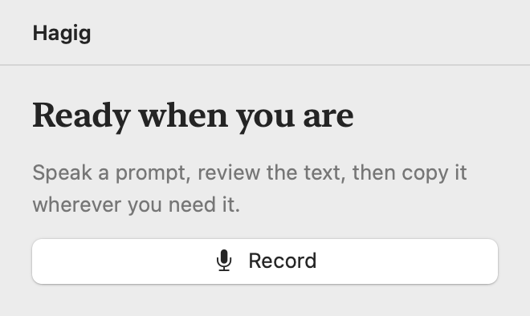
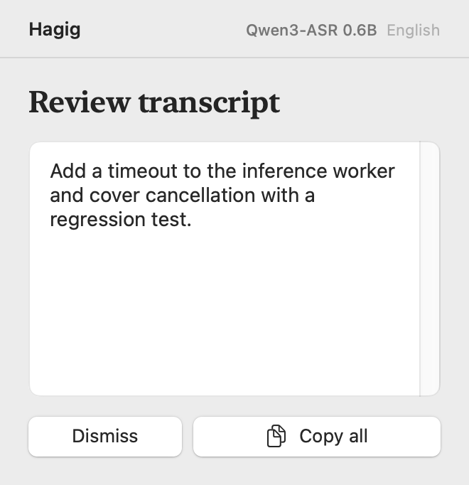
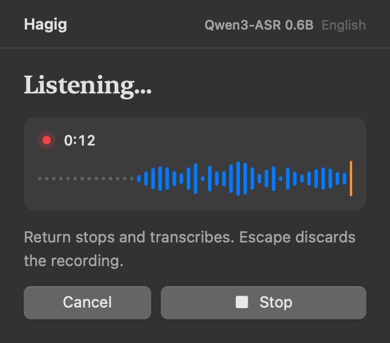

# Hagig

**Think aloud, keep coding.**

Hagig is a privacy-first, local voice-to-text app for dictating instructions to
coding agents. Click the microphone in the macOS menu bar, say what you want, and
Hagig transcribes it on your Mac. You review and edit the text, copy it, and paste
it into Ghostty, Amp or any other tool yourself. Audio never leaves your machine,
and nothing is kept after you dismiss it.

> [!WARNING]
> Hagig is an **experimental development build**, not an accepted alpha. There
> are no releases or installers yet: you build it from source on an Apple Silicon
> Mac. It has run end to end on hosted macOS machines, but not yet been accepted
> on a physical Mac. See [Project status](#project-status).

<table>
  <tr>
    <td align="center" valign="top" width="50%"><br><em>Ready: click Record and speak</em></td>
    <td align="center" valign="top" width="50%"><br><em>Listening: your microphone's level and elapsed time</em></td>
  </tr>
  <tr>
    <td align="center" valign="top"><br><em>Review: edit the transcript, then Copy all</em></td>
    <td align="center" valign="top"><br><em>Setup help: each problem shows the step that fixes it</em></td>
  </tr>
  <tr>
    <td align="center" valign="top"><br><em>Dark mode: listening</em></td>
    <td align="center" valign="top"><br><em>Dark mode: review</em></td>
  </tr>
</table>

*Rendered from the app's own SwiftUI views with the repository's screenshot
harness (`swift run HagigScreenshots states`) and sample text. In the app the
surface appears in a menu-bar popover and follows the system appearance.*

## Quick start

1. **Install:** `just build`, then `just install` (needs Xcode, uv and just; see
   [Installation](#installation)). The first time, choose a model from the
   menu-bar microphone's download button.
2. **Dictate from the keyboard:**
   1. In your terminal or browser, hold **⌃⌥Space** and speak; release to
      transcribe. Or tap to start and tap again to stop. **⌃⌥Esc** cancels.
   2. The transcript opens in a small panel; your app stays in front.
   3. Edit it if needed.
   4. **⌘⇧C** copies it and closes the panel. ⌘A then ⌘C (the whole
      transcript) also closes it; copying part of it leaves the panel open.
      **⌘⇧D** discards it.
   5. Press ⌘V where you were and submit yourself. Hagig never pastes or
      presses Return.

| Key | Does | |
| --- | --- | --- |
| ⌃⌥Space | Hold to talk, or tap to start/stop | default, configurable |
| ⌃⌥Esc | Cancel recording or transcription | default, configurable |
| ⌘⇧C | Copy all and close (in review) | default, configurable |
| ⌘⇧D | Dismiss (in review) | default, configurable |

- **Shortcuts:** change them in Settings, or `[shortcuts]` in
  [`config.toml`](#configuration).
- **Start at login:** turn on **Open at login** in Settings.
- **Logs:** `~/.local/state/hagig/logs` (`just logs`); see [Logs](#logs).
- **Update:** `git pull && just build && just install`.
- **Remove everything:** `just uninstall` ([details](#updating-and-uninstalling)).

## Features

- **Local transcription.** Speech is recognized on your Mac with
  [Qwen3-ASR](https://huggingface.co/Qwen/Qwen3-ASR-0.6B-hf) or
  [Whisper large-v3-turbo](https://huggingface.co/openai/whisper-large-v3-turbo)
  (through Apple's MLX). No account, telemetry or upload.
- **Review before anything leaves Hagig.** The transcript opens in an editor
  (standard or bounded Vim keys). Nothing is pasted or submitted for you.
- **Vocabulary biasing.** List project names and jargon so they come out right.
- **Nothing kept.** Audio is held in memory only while you record; transcripts are
  not saved to disk or logs.
- **Isolated inference.** The model runs in a separate worker process that macOS
  blocks from the network by default.

English only for now. Hagig is built for spoken instructions, not for dictating
source code character by character.

## Requirements

- A Mac with **Apple Silicon** (M1 or later), running macOS 15.3 or later.
- **Xcode 16.4 or 27.2.** The build script accepts only these two versions;
  they can sit beside other Xcode versions. Use 27.2 on macOS 26.2 or later,
  where Apple does not support 16.4. Built with 27.2, the app uses the Liquid
  Glass look and needs macOS 26 or later.
- **[uv](https://docs.astral.sh/uv/)**, to build the bundled Python backend (CI
  uses 0.12.9).
- **[just](https://just.systems)**, which runs the build, install and uninstall
  recipes in the repository's `justfile`.
- About 1.5 GB of disk for the app (it bundles Python, PyTorch and MLX), plus
  1.5–4 GB for a model.

## Installation

Hagig is built from source into a self-contained, ad-hoc-signed `Hagig.app`.

### 1. Install the tools

Install Xcode 16.4 or 27.2 from [Apple's downloads page](https://developer.apple.com/download/all/?q=xcode)
(or with [`xcodes`](https://github.com/XcodesOrg/xcodes)), and open it once so it
finishes installing its components. Then install uv and
[just](https://just.systems):

```sh
curl -LsSf https://astral.sh/uv/install.sh | sh   # or: brew install uv
brew install just
```

### 2. Build and install the app

```sh
git clone https://github.com/mattjmcnaughton/hagig.git
cd hagig
just build
just install
```

`just build` writes `clients/macos/.build/Hagig.app`. It downloads the locked
Python packages, which is its only network step, and takes several minutes the
first time. It uses `/Applications/Xcode_16.4.app` if that exists, otherwise the
Xcode that `xcode-select -p` shows. To pick one, prefix the command, for example
`DEVELOPER_DIR=/Applications/Xcode_27.2.app/Contents/Developer just build`.

`just install` moves the build to `~/Applications/Hagig.app` and opens it. Run
Hagig from there, not from the clone, so it stays at one path across updates.
To install into `/Applications` instead, use
`HAGIG_INSTALL_DIR=/Applications just install`, and set the same variable for the
other recipes.

### 3. Launch

`just install` opens Hagig, and so does `just open` later. A microphone appears in
the menu bar. macOS asks for microphone access the first time you record.
Because the app is signed ad hoc, macOS asks again after each update.

To start Hagig when you log in, turn on **Open at login** in Settings.

### 4. Download a model from the app

Click the menu-bar microphone, then the download button (or **Record**, which
offers **Choose a model…** when none is set up). **Speech models** lists every
model Hagig supports:

| Model | Engine | Download | Notes |
| --- | --- | --- | --- |
| Qwen3-ASR 0.6B | Qwen3-ASR (PyTorch) | ~1.6 GB | Good starting point |
| Qwen3-ASR 1.7B | Qwen3-ASR (PyTorch) | ~4.1 GB | Larger Qwen model |
| Whisper large-v3 turbo | Whisper (MLX) | ~1.6 GB | Runs on the GPU through MLX; converted on install |

Choose **Download…** on one. Hagig shows what it will fetch, from where and how
much, and downloads only after you choose **Download**. That is the one network
step; Hagig never downloads a model on its own. The row shows progress, and
**Cancel** stops it without changing anything already installed. A failed
download says why and offers **Retry**.

The first model you download becomes the one in use, so no settings file has to
be written by hand. Models are pinned to exact revisions, checked against
recorded SHA-256 hashes and stored in `~/.local/share/hagig/models/`.

## Usage

1. Click the menu-bar microphone and choose **Record** (or press Return).
2. Speak. Choose **Stop** (Return) to transcribe, or **Cancel** (Escape) to
   discard. Recording stops at five minutes, with a warning at 4:45.
3. Edit the transcript if needed, then **Copy all** (⌘⇧C) or **Dismiss** (⌘⇧D);
   both chords are configurable.
4. Switch to your terminal or browser, paste and submit yourself.

### From the keyboard, in any app

The steps are in [Quick start](#quick-start). The panel appears near the top of
the screen; your app stays in front and keeps your typing while you record.
Hagig never pastes, presses Return or looks at the app you are in, and the
shortcuts need no Accessibility or Input Monitoring permission. Clicking the
menu-bar icon while the panel shows moves it into the popover.

Copy uses the macOS current-device-only option, so the text is not shared to your
other devices through Universal Clipboard. The menu-bar icon shows whether Hagig is
recording or transcribing. Right-click it to quit.

## Configuration

Open **Settings** (the gear in the popover) to choose the model in use, the
review editor (Standard or Vim), vocabulary terms that bias transcription toward
names and jargon, and whether the transcription worker's network is blocked by
macOS (on by default), and the shortcuts: record and cancel (global), and
Copy all and Dismiss (only while a transcript is in review). **Save** validates
them, writes them, and applies them to the next recording; shortcuts change at
once. If another app already uses a shortcut, Settings says so. Switching models
is the **Use** button in **Speech models**. **Open at login** (also in Settings)
applies immediately; macOS may ask you to allow it in System Settings › Login Items.

They live in `~/.config/hagig/config.toml` (or `$XDG_CONFIG_HOME/hagig/config.toml`),
which you can also edit by hand. Saving from the app rewrites the file without its
comments. Only `[model] id` is required:

```toml
[model]
id = "qwen3-asr-0.6b"   # or "qwen3-asr-1.7b", "whisper-large-v3-turbo"

[editor]
mode = "standard"       # or "vim" for bounded Vim editing in review

[vocabulary]
terms = ["Hagig", "Ghostty", "Qwen", "Amp"]   # names and jargon to bias toward

[inference]
network_isolation = "required"   # default; "disabled" explicitly opts out

[shortcuts]
record = "ctrl+option+space"     # default; global
cancel = "ctrl+option+escape"    # default; global
copy = "cmd+shift+c"             # default; Copy all and close, in review only
dismiss = "cmd+shift+d"          # default; Dismiss, in review only
```

A shortcut is one or more of `cmd`, `ctrl`, `option` and `shift` plus one key:
`a`–`z`, `0`–`9`, `f1`–`f12`, `space`, `return`, `tab`, `escape`, `minus`,
`equal`, `comma`, `period`, `slash` or `semicolon`, joined by `+` in lowercase.
Keys are positions on a US keyboard, whatever your layout. All four must differ.
Give `copy` and `dismiss` a `cmd` chord: without one the review editor (for
example its Vim keys) may take the key first.

Hagig runs a small per-user transcription service that stays warm after the app
quits. It reads settings when it starts. Saving in the app restarts it when it is
idle; after editing the file by hand, restart it yourself:

```sh
just stop
```

The app starts it again on the next recording. The bundle's `hagig` helper offers
`model list`, `model install <id>` and `settings show|set` for scripting.

### Logs

The app and the service each keep a log in `~/.local/state/hagig/logs/` (or
`$XDG_STATE_HOME/hagig/logs/`): `app.log` and `server.log`. Settings shows the
folder with **Show in Finder**, and `just logs` opens it. Each line is a fixed
event (recording started, request completed, worker exited, a failure's stable
code, a duration) and never contains transcripts, audio, vocabulary, settings
or file paths. Each file is kept under about 1 MiB, with one older copy
(`.1`). The transcription worker's own output is discarded.

### Transcribing audio files

The same helper is a command-line client of the service:

```sh
HAGIG="$HOME/Applications/Hagig.app/Contents/Helpers/hagig"
"$HAGIG" transcribe recording.wav   # prints the transcript
"$HAGIG" status                     # service status, or "stopped"
"$HAGIG" stop                       # stop the service and its worker
```

`transcribe` accepts 16-bit or 32-bit float PCM WAV, mono or stereo, at 16, 44.1
or 48 kHz, up to five minutes long.

## Updating and uninstalling

To update, pull and rebuild, then install over the running copy:

```sh
git pull
just build
just install
```

`just install` quits Hagig and stops its service before replacing the app, then
opens the new one. Your settings, models and **Open at login** carry over. The
replaced app is kept as `clients/macos/.build/Hagig.previous.app` until the next
install. To roll back, quit Hagig, run `just stop`, then replace
`~/Applications/Hagig.app` with that copy.

To uninstall, run:

```sh
just uninstall
```

It lists everything it will remove and asks once. Then it turns off **Open at
login**, quits Hagig, stops the service, resets its microphone access and
deletes:

| What | Where |
| --- | --- |
| The app | `~/Applications/Hagig.app`, plus any builds in `clients/macos/.build/` |
| Settings | `~/.config/hagig` |
| Models (1.5–4 GB each) | `~/.local/share/hagig` |
| Logs | `~/.local/state/hagig` |
| Service runtime files | `hagig` in your per-user temporary folder |

It leaves the clone and uv's download cache alone; delete the clone yourself.

### Running `hagig` without the full path

The helper finds the app from its own path, so a symlink to it does not work.
Use an alias, or put the app's `Helpers` directory on your `PATH`, for example
in `~/.zshrc`:

```sh
alias hagig="$HOME/Applications/Hagig.app/Contents/Helpers/hagig"
# or
export PATH="$HOME/Applications/Hagig.app/Contents/Helpers:$PATH"
```

## Privacy

Normal dictation works offline, with no telemetry, uploads or automatic
downloads. Building the app and a model download you confirm are the only steps that use
the network. Hagig does not save recordings or transcripts, and keeps your
vocabulary out of logs and error messages. Inference runs in a separate process
that the macOS sandbox blocks from the network unless you explicitly disable
isolation.

What Hagig cannot control: clipboard managers and the apps you paste into may keep
or transmit the text, and cancelling cannot undo a copy that already happened.

These are the project's [commitments](docs/CONSTITUTION.md). Source inspection,
runtime observation and blocked-network runs have been recorded on hosted macOS
for both engines (see [backend guidance](backend/AGENTS.md#engine-auto-download-audit-49)),
but no dependency has passed its privacy adoption gate, and finite tests cannot
prove absolute privacy.

## Project status

What exists on `main`:

- **macOS app** (#21, #22): menu-bar Record/Stop/Cancel, global record/cancel
  shortcuts with a panel that keeps your app in front (no native evidence yet),
  open at login, live level, editable
  review (standard or Vim), current-device-only Copy, and setup help for a missing
  settings file, missing model, denied microphone and other failures.
- **Python backend** (#43–#45, #47, #49): per-user server on a private Unix
  socket, isolated inference worker, CLI, pinned model installs, and both engines
  running under the macOS sandbox.
- **Local app bundle** (#48, toward #23): `bundle.sh` packs the app, a Python
  interpreter and the backend into one relocatable `Hagig.app`.

Evidence so far: on 2026-11-19 a bundle was driven end to end on a hosted macOS
15.7.5 virtual machine with synthesized speech through a virtual audio device.
Both engines transcribed into review, Copy wrote the edited text, and silence,
Cancel, a missing settings file, a missing model and denied microphone access each
ended in the expected state. The synthetic demo was also checked on hosted macOS
26.3.1; built with Xcode 16.4 the app keeps the pre-Liquid Glass appearance there.

Not yet established: physical-Mac microphone, permission and rebuild behavior;
second-device clipboard locality; model quality; privacy and inference adoption
(#21, #23, #10). Room noise from a real microphone can still produce stray text
(AC9 is partly open). Packaging and releases are tracked in #24.

## How it works

- **Swift macOS app** (`clients/macos/`): menu-bar UI, microphone capture,
  permissions, in-memory editing and Copy.
- **Python server** (`backend/`): one request at a time over HTTP/1.1 on a
  Unix-domain socket protected by file permissions; no TCP listener.
- **Python worker**: runs the speech model in a separate, sandboxed process and
  stays warm between requests.
- **Python CLI**: `hagig`, a sibling client for model installs, audio files and
  controlling the server.

The [MVP product requirements](docs/product/prds/01-mvp.md) own scope and
acceptance, and the [technical design](docs/technical/tdds/01-mvp.md) owns the
protocol, paths and model pins. The [product prototype](docs/product/prototypes/README.md)
is a browser simulation of the reviewed UI concept.

## Contributing

Read [AGENTS.md](AGENTS.md) and the [constitution](docs/CONSTITUTION.md) first.
Developer commands, checks and the kinds of evidence each gives live in the
[macOS guidance](clients/macos/AGENTS.md) and [backend guidance](backend/AGENTS.md).
Linux can run the portable Python checks; macOS is needed for the app, the
sandbox and inference.

## Name

Inspired by Biblical Hebrew הֲגִיג, provisionally associated with murmuring or
musing; the precise wording remains to be verified.

## License

Hagig's own source is licensed under the [MIT License](LICENSE). Third-party
libraries and model assets keep their own licenses (Qwen3-ASR: Apache-2.0;
Whisper: MIT), and their notice and attribution obligations must be satisfied
before any redistribution (#24).
