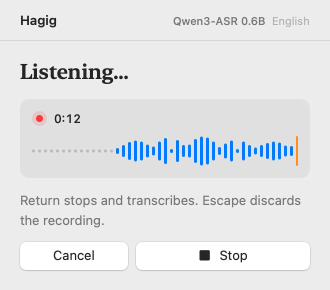
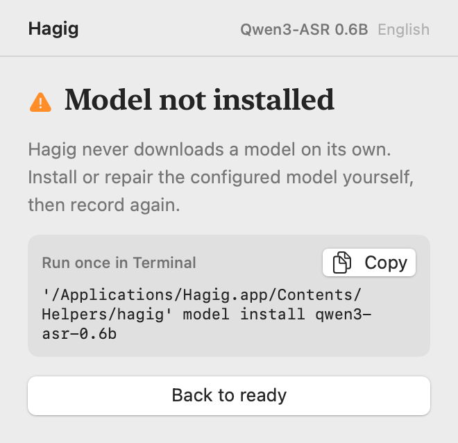
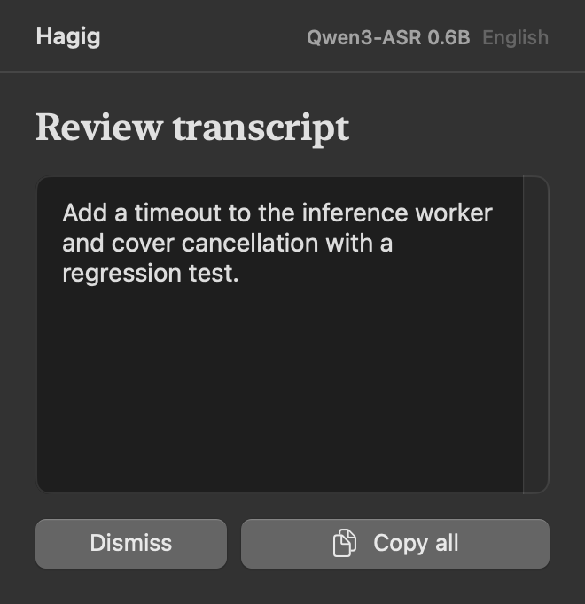

# Hagig

**Think aloud, keep coding.**

Hagig is a privacy-first, local voice-to-text app for dictating instructions to
coding agents. Click the microphone in the macOS menu bar, say what you want, and
Hagig transcribes it on your Mac. You review and edit the text, copy it, and paste
it into Ghostty, Amp or any other tool yourself. Audio never leaves your machine,
and nothing is kept after you dismiss it.

> [!WARNING]
> Hagig is an **experimental development build**, not an accepted alpha. There
> are no releases or installers yet: you build it from source on an Apple Silicon
> Mac. It has run end to end on hosted macOS machines, but not yet been accepted
> on a physical Mac. See [Project status](#project-status).

<table>
  <tr>
    <td align="center" valign="top" width="50%"><br><em>Ready: click Record and speak</em></td>
    <td align="center" valign="top" width="50%"><br><em>Listening: your microphone's level and elapsed time</em></td>
  </tr>
  <tr>
    <td align="center" valign="top"><br><em>Review: edit the transcript, then Copy all</em></td>
    <td align="center" valign="top"><br><em>Setup help: each problem shows the step that fixes it</em></td>
  </tr>
  <tr>
    <td align="center" valign="top"><br><em>Dark mode: listening</em></td>
    <td align="center" valign="top"><br><em>Dark mode: review</em></td>
  </tr>
</table>

*Rendered from the app's own SwiftUI views with the repository's screenshot
harness (`swift run HagigScreenshots states`) and sample text. In the app the
surface appears in a menu-bar popover and follows the system appearance.*

## Features

- **Local transcription.** Speech is recognized on your Mac with
  [Qwen3-ASR](https://huggingface.co/Qwen/Qwen3-ASR-0.6B-hf) or
  [Whisper large-v3-turbo](https://huggingface.co/openai/whisper-large-v3-turbo)
  (through Apple's MLX). No account, telemetry or upload.
- **Review before anything leaves Hagig.** The transcript opens in an editor
  (standard or bounded Vim keys). Nothing is pasted or submitted for you.
- **Vocabulary biasing.** List project names and jargon so they come out right.
- **Nothing kept.** Audio is held in memory only while you record; transcripts are
  not saved to disk or logs.
- **Isolated inference.** The model runs in a separate worker process that macOS
  blocks from the network by default.

English only for now. Hagig is built for spoken instructions, not for dictating
source code character by character.

## Requirements

- A Mac with **Apple Silicon** (M1 or later), running macOS 15.3 or later.
- **Xcode 16.4.** The build script requires exactly this version; it can sit
  beside other Xcode versions.
- **[uv](https://docs.astral.sh/uv/)**, to build the bundled Python backend (CI
  uses 0.12.9).
- About 1.5 GB of disk for the app (it bundles Python, PyTorch and MLX), plus
  1.5–4 GB for a model.

## Installation

Hagig is built from source into a self-contained, ad-hoc-signed `Hagig.app`.

### 1. Install the tools

Install Xcode 16.4 from [Apple's downloads page](https://developer.apple.com/download/all/?q=xcode%2016.4)
(or with [`xcodes`](https://github.com/XcodesOrg/xcodes)), and open it once so it
finishes installing its components. Then install uv:

```sh
curl -LsSf https://astral.sh/uv/install.sh | sh   # or: brew install uv
```

### 2. Build the app

```sh
git clone https://github.com/mattjmcnaughton/hagig.git
cd hagig

# Point at your Xcode 16.4 if it is not at this path.
export DEVELOPER_DIR=/Applications/Xcode_16.4.app/Contents/Developer
bash clients/macos/bundle.sh build
```

This writes `clients/macos/.build/Hagig.app`. The build downloads the locked
Python packages; that is its only network step.

### 3. Choose and install a model

Create the settings file with the model you want:

```sh
mkdir -p ~/.config/hagig
printf '[model]\nid = "qwen3-asr-0.6b"\n' > ~/.config/hagig/config.toml
```

| Model ID | Engine | Download | Notes |
| --- | --- | --- | --- |
| `qwen3-asr-0.6b` | Qwen3-ASR (PyTorch) | ~1.6 GB | Good starting point |
| `qwen3-asr-1.7b` | Qwen3-ASR (PyTorch) | ~4.1 GB | Larger Qwen model |
| `whisper-large-v3-turbo` | Whisper (MLX) | ~1.6 GB | Runs on the GPU through MLX; converted on install |

Then install it with the app's own command-line helper. This is the one explicit
model download; Hagig never downloads a model on its own.

```sh
HAGIG="$PWD/clients/macos/.build/Hagig.app/Contents/Helpers/hagig"
"$HAGIG" model install qwen3-asr-0.6b
```

The later commands use this `$HAGIG` variable too.

Models are pinned to exact revisions, checked against recorded SHA-256 hashes and
stored in `~/.local/share/hagig/models/`.

### 4. Launch

```sh
open clients/macos/.build/Hagig.app
```

A microphone appears in the menu bar. macOS asks for microphone access the first
time you record. Because the app is signed ad hoc, macOS asks again after each
rebuild.

## Usage

1. Click the menu-bar microphone and choose **Record** (or press Return).
2. Speak. Choose **Stop** (Return) to transcribe, or **Cancel** (Escape) to
   discard. Recording stops at five minutes, with a warning at 4:45.
3. Edit the transcript if needed, then **Copy all** (⌘⇧C) or **Dismiss** (⌘⇧D).
4. Switch to your terminal or browser, paste and submit yourself.

Copy uses the macOS current-device-only option, so the text is not shared to your
other devices through Universal Clipboard. The menu-bar icon shows whether Hagig is
recording or transcribing. Right-click it to quit.

## Configuration

Settings live in `~/.config/hagig/config.toml` (or `$XDG_CONFIG_HOME/hagig/config.toml`).
Only `[model] id` is required:

```toml
[model]
id = "qwen3-asr-0.6b"   # or "qwen3-asr-1.7b", "whisper-large-v3-turbo"

[editor]
mode = "standard"       # or "vim" for bounded Vim editing in review

[vocabulary]
terms = ["Hagig", "Ghostty", "Qwen", "Amp"]   # names and jargon to bias toward

[inference]
network_isolation = "required"   # default; "disabled" explicitly opts out
```

Hagig runs a small per-user transcription service that stays warm after the app
quits. Settings are read when it starts, so after editing them (or installing a
different model) restart it:

```sh
"$HAGIG" stop
```

The app starts it again on the next recording.

### Transcribing audio files

The same helper is a command-line client of the service:

```sh
"$HAGIG" transcribe recording.wav   # prints the transcript
"$HAGIG" status                     # service status, or "stopped"
"$HAGIG" stop                       # stop the service and its worker
```

`transcribe` accepts 16-bit or 32-bit float PCM WAV, mono or stereo, at 16, 44.1
or 48 kHz, up to five minutes long.

## Updating and uninstalling

To update, quit Hagig, run `"$HAGIG" stop`, move the old bundle aside (the build
refuses to overwrite one), pull and rebuild:

```sh
"$HAGIG" stop
mv clients/macos/.build/Hagig.app clients/macos/.build/Hagig.previous.app
git pull
bash clients/macos/bundle.sh build
open clients/macos/.build/Hagig.app
```

To uninstall, quit Hagig, then run:

```sh
"$HAGIG" uninstall
```

It lists what it will remove and asks before doing anything (`--yes` skips the
question). It stops the service, then deletes your settings
(`~/.config/hagig`), your models (`~/.local/share/hagig`, 1.5–4 GB each) and the
service's runtime files. It leaves the app itself alone and prints the last two
steps: delete `Hagig.app` and reset its microphone permission with
`tccutil reset Microphone com.mattjmcnaughton.hagig`.

### Running `hagig` without the full path

The helper finds the app from its own path, so a symlink to it does not work.
Use an alias or put the app's `Helpers` directory on your `PATH`, for example
in `~/.zshrc`:

```sh
alias hagig="$HOME/src/hagig/clients/macos/.build/Hagig.app/Contents/Helpers/hagig"
# or
export PATH="$HOME/src/hagig/clients/macos/.build/Hagig.app/Contents/Helpers:$PATH"
```

Replace `$HOME/src/hagig` with where you cloned the repository.

## Privacy

Normal dictation works offline, with no telemetry, uploads or automatic
downloads. Building the app and `hagig model install` are the only steps that use
the network. Hagig does not save recordings or transcripts, and keeps your
vocabulary out of logs and error messages. Inference runs in a separate process
that the macOS sandbox blocks from the network unless you explicitly disable
isolation.

What Hagig cannot control: clipboard managers and the apps you paste into may keep
or transmit the text, and cancelling cannot undo a copy that already happened.

These are the project's [commitments](docs/CONSTITUTION.md). Source inspection,
runtime observation and blocked-network runs have been recorded on hosted macOS
for both engines (see [backend guidance](backend/AGENTS.md#engine-auto-download-audit-49)),
but no dependency has passed its privacy adoption gate, and finite tests cannot
prove absolute privacy.

## Project status

What exists on `main`:

- **macOS app** (#21, #22): menu-bar Record/Stop/Cancel, live level, editable
  review (standard or Vim), current-device-only Copy, and setup help for a missing
  settings file, missing model, denied microphone and other failures.
- **Python backend** (#43–#45, #47, #49): per-user server on a private Unix
  socket, isolated inference worker, CLI, pinned model installs, and both engines
  running under the macOS sandbox.
- **Local app bundle** (#48, toward #23): `bundle.sh` packs the app, a Python
  interpreter and the backend into one relocatable `Hagig.app`.

Evidence so far: on 2026-11-19 a bundle was driven end to end on a hosted macOS
15.7.5 virtual machine with synthesized speech through a virtual audio device.
Both engines transcribed into review, Copy wrote the edited text, and silence,
Cancel, a missing settings file, a missing model and denied microphone access each
ended in the expected state. The synthetic demo was also checked on hosted macOS
26.3.1; built with Xcode 16.4 the app keeps the pre-Liquid Glass appearance there.

Not yet established: physical-Mac microphone, permission and rebuild behavior;
second-device clipboard locality; model quality; privacy and inference adoption
(#21, #23, #10). Room noise from a real microphone can still produce stray text
(AC9 is partly open). Packaging and releases are tracked in #24.

## How it works

- **Swift macOS app** (`clients/macos/`): menu-bar UI, microphone capture,
  permissions, in-memory editing and Copy.
- **Python server** (`backend/`): one request at a time over HTTP/1.1 on a
  Unix-domain socket protected by file permissions; no TCP listener.
- **Python worker**: runs the speech model in a separate, sandboxed process and
  stays warm between requests.
- **Python CLI**: `hagig`, a sibling client for model installs, audio files and
  controlling the server.

The [MVP product requirements](docs/product/prds/01-mvp.md) own scope and
acceptance, and the [technical design](docs/technical/tdds/01-mvp.md) owns the
protocol, paths and model pins. The [product prototype](docs/product/prototypes/README.md)
is a browser simulation of the reviewed UI concept.

## Contributing

Read [AGENTS.md](AGENTS.md) and the [constitution](docs/CONSTITUTION.md) first.
Developer commands, checks and the kinds of evidence each gives live in the
[macOS guidance](clients/macos/AGENTS.md) and [backend guidance](backend/AGENTS.md).
Linux can run the portable Python checks; macOS is needed for the app, the
sandbox and inference.

## Name

Inspired by Biblical Hebrew הֲגִיג, provisionally associated with murmuring or
musing; the precise wording remains to be verified.

## License

Hagig's own source is licensed under the [MIT License](LICENSE). Third-party
libraries and model assets keep their own licenses (Qwen3-ASR: Apache-2.0;
Whisper: MIT), and their notice and attribution obligations must be satisfied
before any redistribution (#24).
